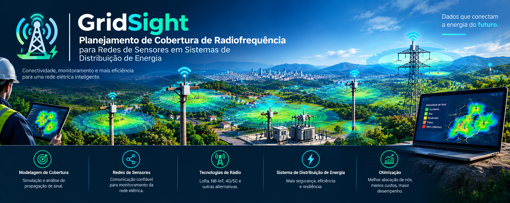

  

# GridSight — planejamento de gateways com relevo

Importação por distribuidora (caixas de seleção), criação manual de ativos e candidatos, mapa OpenStreetMap,
comparação de cenários — e o **relevo** (arquivos SRTM `.hgt`) entrando no cálculo de cobertura.

## Como rodar
1. **Baixar os dados (um comando só).** Na pasta `dados`:
   `py -m pip install -r requirements.txt` (só na primeira vez) e depois `py gridsight_dados.py`
   (ou dê dois cliques em `dados\rodar.bat`). Ele baixa as 30 principais distribuidoras da ANEEL, gera
   `dados/gridsight_dados_aneel_30.sql` (ativos e candidatos), baixa o relevo SRTM para `backend/terrain/` e
   árvores e prédios do OpenStreetMap para `backend/clutter/`. Para testar antes: `py gridsight_dados.py --max 2`.
   Veja todas as opções em `dados/README.md`. Demora e usa bastante disco (~10 GB livres).
2. **Banco (MySQL):** rode o `.sql` no Workbench (banco `tecsys_gateway`): `dados/gridsight_dados_aneel_30.sql`
   (as 30 distribuidoras) ou, para só as 5 iniciais, `dados/gridsight_dados_aneel.sql`.
   **Usuário e senha do banco não ficam no código:** defina as variáveis de ambiente `DB_USERNAME` (padrão `root`) e
   `DB_PASSWORD` (no IntelliJ: Run > Edit Configurations > Environment variables). Não escreva a senha no `application.properties`.
3. **Backend:** na pasta `backend`, `mvn spring-boot:run` (ou rode `GatewayPlannerApplication` no IntelliJ, aberto na pasta `backend`).
   Java 17+; o `pom.xml` já fixa o Lombok 1.18.46 e o processador de anotações (necessário no Java 23+).
   Se a porta 8080 estiver ocupada: `netstat -ano | findstr :8080` e `taskkill /PID <número> /F`.
   O log deve mostrar `Relevo: N arquivo(s) .hgt em ...`.
   **Não é preciso copiar os `.hgt`:** ao calcular com relevo, o backend baixa sozinho os ladrilhos que faltarem
   (cópia pública da AWS, só na primeira vez de cada região; o computador do backend precisa de internet).
4. **Frontend:** na pasta `frontend`, `flutter pub get` e `flutter run -d chrome`
   (se o Chrome reclamar de web: `flutter create .`). `main.dart` usa `http://localhost:8080/api`.
   Depois de trocar arquivos, pare e rode de novo (hot reload pode manter o código antigo).

## Parâmetros
Alcance máximo, potência, meta de cobertura, máximo de gateways, (a altura da antena, 6 m, e a margem de segurança, 0 dB, ficam fixas e não aparecem na tela),
e a chave **Relevo**. Fixos: 915 MHz, sensibilidade -120 dBm, ativo a 5 m.

## O que aparece no mapa (com relevo)
- **Círculo branco:** alcance sem relevo. **Verde:** onde o sinal chega. **Magenta (piscam com o botão Relevo ligado):** só onde há rede (até 6 km de algum ativo) e até 15 km do gateway, e nenhum gateway escolhido atende.
- **Ícones de morro com a altitude:** o relevo que bloqueia. Ativos magenta sem sinal: toque para piscar e ver a altitude do local e do morro.
- **Botão de morro (canto direito):** sugere pontos altos para gateways novos; ao confirmar, o ponto vira candidato e a otimização é refeita.
- **Painel da direita:** gateways sem relevo x com relevo.
- **Camadas → "Relevo":** sombreado do terreno recortado no formato de SP.

## Limites (leia)
- Modelo próprio (espaço livre + difração, Deygout), comparado com o Longley-Rice em 600 enlaces de SP de 0,8 a 10 km:
  correlação 0,92, em média ~5 dB mais otimista (desvio ±7 dB). **Acima de ~10 km é extrapolação.** Não é medição de campo.
- O relevo (~90 m de resolução) não mostra prédios nem árvores; com a chave **Árvores e prédios** eles vêm do OpenStreetMap (só existem onde o mapa está mapeado; prédios entram como caixas e as clareiras dentro de matas são ignoradas). Ganho de antena e interferência não entram.
- Os ativos e candidatos são uma amostra da BDGD/ANEEL; Enel/Neoenergia/Piratininga não têm transformadores como candidatos no SQL.
- O contorno de SP é uma versão simplificada de dado público (faltam algumas ilhas, como Ilhabela).
- Cenários reabertos do banco não trazem os detalhes de relevo (só o resumo).
- Alcance efetivo acima de 100 km é limitado a 100 km no cálculo com relevo.

## Pastas
`backend/` Spring Boot (`rf/` motor de RF, `planning/` planejamento, `service/TerrainService` acha os .hgt) ·
`frontend/` Flutter · `dados/` script que baixa tudo (`gridsight_dados.py`) e SQL das 5 distribuidoras · `scripts/` baixa só .hgt · testes em `backend/src/test`.

## Recursos do app

- **PDF do cenário** (Indicadores, Painel e Comparar Cenários): resumo, parâmetros, relevo, redundância, mapa esquemático e gateways.
- **Comparar cenários**: gráfico de cobertura, tabela lado a lado, abrir no mapa e reutilizar parâmetros.
- **Importar dados por região**: distribuidoras em caixas por região do país (Norte, Nordeste, Centro-Oeste, Sudeste, Sul e cooperativas), com busca e "marcar todas".
- **Perfil de elevação do enlace**: toque num ativo no mapa e escolha "Ver perfil de elevação" (terreno, linha de visada e zona de Fresnel).
- **Mapa de calor do sinal** e **redundância** (camadas do mapa).
- **Ativos descobertos** piscam bem devagar, mantendo a cor.
- **Filtros do mapa**: distribuidora, tipo de ativo, tipo de candidato e situação (coberto, descoberto, com/sem reserva).
- **Relevo em cor de terra só nas distribuidoras escolhidas**, em qualquer lugar do Brasil.
- **Painel** com dados por distribuidora, tipos, situação do relevo e último cenário.

Depois de atualizar o código, rode `flutter pub get` (novas dependências: `pdf` e `printing`).

## Novidades 

- **Cidade e bairro** de qualquer ativo, candidato ou gateway: a cidade vem na hora da lista dos 5.570 municípios do IBGE (`frontend/assets/data/municipios.csv`, aproximada); o bairro vem do OpenStreetMap ao tocar (ou do cadastro da distribuidora).
- **Transformar ativo em gateway**: toque no ativo e use "Transformar em gateway" (funciona também com o mapa afastado).
- **Ajuste manual de gateway rápido**: o app envia só os gateways marcados e o backend calcula cobertura e sombras em paralelo.
- **Redundância**: ativo atendido por um único gateway aparece maior e em âmbar.
- **Relatórios em PDF** (painel de camadas): "Baixar gateways (PDF)" e "Baixar ativos sem sinal (PDF)", em tabela legível, página deitada.
